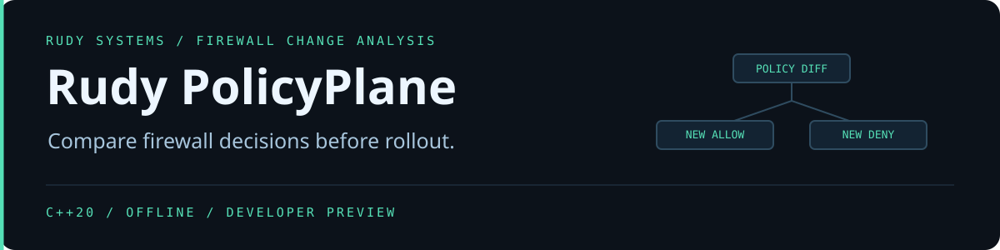

**Review the traffic a firewall change would affect before rollout.** PolicyPlane compares two ordered IPv4 policies offline. It reports disjoint traffic regions where decisions change, the matching rule in each policy, and a representative flow for each region. A CI gate can fail whenever the proposed policy permits new traffic.

## Try the sample

Download a [native package](https://github.com/r4venrudy/rudy-policyplane/releases), verify its SHA-256 against SHA256SUMS.txt, and extract it. Append .exe to the executable name on Windows.

~~~sh
bin/policyplane audit examples/before.policy
bin/policyplane diff examples/before.policy examples/after.policy --fail-on-new-allow
bin/policyplane match examples/before.policy tcp 198.51.100.2 192.0.2.7 22
~~~

The sample widens TCP/443 access, narrows UDP/9000 access, and includes an unreachable rule for TCP/22. The first matching rule decides each flow.

## Input

Each text file declares one fallback and lists rules in evaluation order. Comments begin with #.

~~~text
default deny
example allow tcp 198.51.100.0/24 192.0.2.0/24 443
~~~

Rule fields are ID, action, protocol, source, destination, and destination port. Addresses can be IPv4 CIDRs with zero host bits, single addresses, or *. Ports can be a single decimal port, an inclusive range such as 8000-8099, or *. Use * for ICMP and for the any protocol selector. The model covers TCP, UDP, and ICMP over IPv4. It uses one stateless chain and an explicit default. Translate vendor exports into this format with the intended rule order and chain direction. NAT, connection state, interface conditions, source ports, IPv6, and ICMP type and code are outside the model.

## Output and limits

| Command | Evidence |
| --- | --- |
| audit | Rule IDs, whether any modeled flow reaches each rule, and region counts by protocol |
| diff | Inclusive source, destination, and port ranges, verdicts and matching rule IDs, and one example flow per region |
| match | Verdict and rule ID for a single flow |

Internally the engine subtracts matched rectangles from undecided packet space, then intersects regions with opposite verdicts across the two policies. JSON regions are disjoint and may split along provenance boundaries. Region counts measure report entries. Each input is limited to 512 KiB and 2,048 rules. Full analysis stops at five million intersections or 50,000 regions per protocol partition or result. Single-flow matching evaluates the rules directly.

Exit 0 means success. Exit 2 indicates invalid input, an analysis limit, or an output error. Exit 3 means the comparison emitted a report and the requested gate found newly allowed traffic.

## Build and test

Use CMake 3.20 or newer, a C++20 compiler, and Python 3.9 or newer for tests. The native binary has no third-party library dependency.

~~~sh
cmake -S . -B build -DCMAKE_BUILD_TYPE=Release
cmake --build build --config Release
ctest --test-dir build -C Release --output-on-failure
cmake --install build --config Release --prefix stage
~~~

[IPv4 CIDR reference](https://www.rfc-editor.org/rfc/rfc4632.html)
